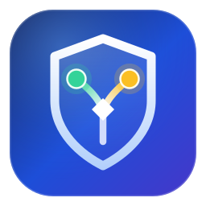
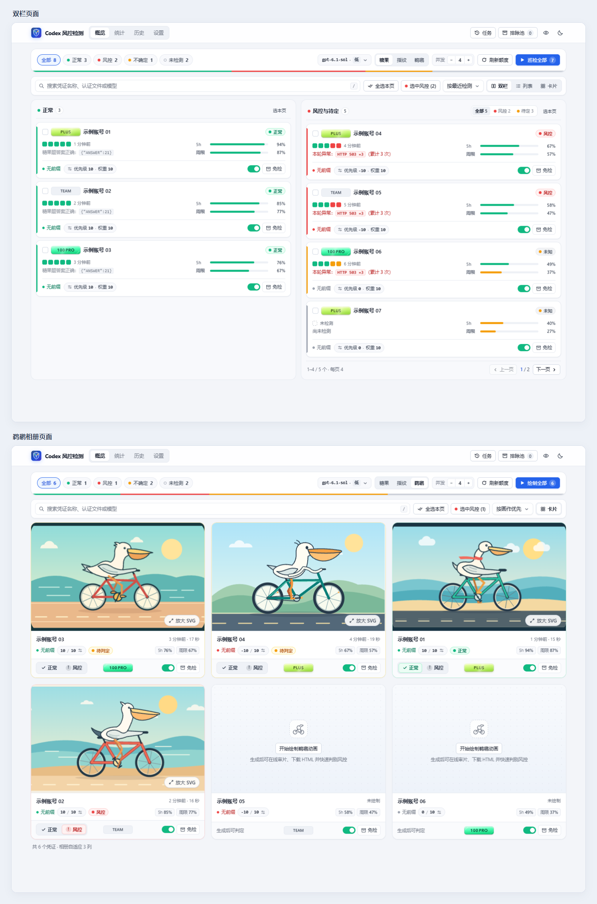

<p align="center">
  
</p>

<h1 align="center">Codex 风控检测与分类插件</h1>

<p align="center">
  <a href="https://go.dev/"></a>
  <a href="https://react.dev/"></a>
  <a href="https://www.typescriptlang.org/"></a>
  <a href="https://vite.dev/"></a>
  <a href="https://github.com/router-for-me/CLIProxyAPI"></a>
</p>

面向 [CLIProxyAPI](https://github.com/router-for-me/CLIProxyAPI)（CPA）的 Codex 凭证风控检测与分组管理原生动态库插件（`cpa-gpt-risk-group-plugin`）。支持通过糖果题校验、三次采样模型指纹归因或「画鹈鹕」HTML/SVG 动画巡检凭证输出质量与异常状态，默认采用「仅检测」模式，也可按需自动写入模型前缀或调度优先级。

## 功能特性

- **多方式巡检**：支持手动、批量与定时巡检，内置糖果题校验、三次采样模型指纹归因与「画鹈鹕」HTML+SVG 2D 动画验证（支持沉浸式相册展示、大图快速审片台、本地下载 HTML 与肉眼分组）；每轮任务冻结配置，支持并发步进调节与退避重试。
- **快捷模型与策略切换**：首页直接切换聊天检测模型（自动过滤生图、决策等非聊天模型，支持滚动定位、双击直存与 `Ctrl/Cmd + Enter` 保存）、思考等级（低 / 中 / 高）与分组写入策略（`仅检测` / `模型前缀` / `仅优先级`）。
- **凭证管理与多视图**支持悬停一键单凭证快测、`Shift` 区间连选、同步启停 CPA 凭证、手动移入免检排除池、Free 账号默认免检（可在设置中强制开启）、账号名脱敏、单凭证权重调节（加权轮询），以及双栏、列表、自适应列数卡片与鹈鹕动画相册视图。
- **额度与异常保护**：支持主动刷新当前页凭证的 5h / 周限 / 月限额度；支持配置全局及定时巡检独立的剩余额度门槛、活跃会话限制与频繁 502/503/429 风控判定规则，并在异常说明与悬浮提示中保留最后错误码。
- **可追溯证据与多日统计**：按批次记录题目、回答摘要、请求耗时与同步结果，点击近况灯可查看完整判定依据；统计近 7 / 14 / 30 个北京时间自然日的巡检覆盖率与风控占比。
- **内嵌同源控制台**：原生共享库内嵌 React 单页管理界面，复用 CPA 管理密钥鉴权与内核 Codex CLI 请求头配置，无需额外部署独立后端。

## 控制台预览

截图中的凭证、额度与巡检状态为演示数据。

<p align="center">
  
</p>

## 安装与启用

需要支持原生插件 **C ABI 1**（自动协商管理接口 **RPC Schema ≤ 6**）的 CPA 宿主。插件 ID 为 `cpa-gpt-risk-group-plugin`，动态库的操作系统与架构须与 CPA 进程一致。商店与接口路径参照 [CLIProxyAPI v8.1.2 管理接口](https://github.com/router-for-me/CLIProxyAPI/blob/v8.1.2/docs/management-api-v8.md)。

### 通过插件商店安装

先在 CPA 中启用原生插件。使用本仓库发布源时，将下面的清单地址加入现有 `plugins.store-sources`，再到 **CPA 管理面板 → 插件商店** 搜索 **Codex 风控检测与分类** 并安装。商店需要仓库已发布与当前宿主平台匹配的安装包。

```yaml
plugins:
  enabled: true
  store-sources:
    - "https://raw.githubusercontent.com/UangSC/cpa-gpt-risk-group-plugin/main/store/registry.json"
```

插件商店会按宿主平台选择归档，通过 `checksums.txt` 校验安装包，并启用本插件。CPA 使用默认的本机回环 HTTP 端口时，可直接打开插件页面，沿用已登录的管理密钥。

### 手动安装

从 [GitHub Releases](https://github.com/UangSC/cpa-gpt-risk-group-plugin/releases) 下载对应平台的归档包，使用同一版本的 `checksums.txt` 核对 SHA-256 后，将共享库放入 CPA 插件目录：

| 运行平台 | 架构 | 共享库 |
| --- | --- | --- |
| Linux | amd64（x86-64） | `.so` |
| Linux | arm64（AArch64） | `.so` |
| Windows | amd64（x64） | `.dll` |

参照 [插件配置示例](examples/plugin-config.yaml) 在 CPA 配置中启用插件。默认设置可用于本机回环 HTTP 端口 8317：

```yaml
plugins:
  enabled: true
  configs:
    cpa-gpt-risk-group-plugin:
      enabled: true
      api_base: http://127.0.0.1:8317
      management_key: ""
      state_dir: ""
```

### 使用 AI 助手快速安装

可将以下提示词复制给能够操作目标机器的 AI 助手协助部署：

```text
请协助我在现有的 CLIProxyAPI（CPA）实例中安装 Codex 风控检测与分类插件。
项目仓库为 https://github.com/UangSC/cpa-gpt-risk-group-plugin 。

1. 识别目标 CPA 实例、配置路径、运行平台与进程架构，确认宿主支持原生插件 C ABI 1 和管理接口 RPC Schema 6。
2. 优先启用 CPA 原生插件，添加仓库商店清单，从商店安装与目标平台匹配的版本。
3. 手动安装时先备份原配置、插件文件与状态目录，再从 Releases 下载匹配的安装包并核对 checksums.txt。沿用 CPA 已有管理登录或 MANAGEMENT_PASSWORD，管理密钥勿输出至日志。
4. 启用后确认插件 cpa-gpt-risk-group-plugin 注册状态与版本无误，并给出可打开的管理页面路径与备份位置。
```

## 使用方法

### 访问控制台

插件启用后，可通过 CPA 管理界面插件入口打开，或访问当前 CPA 实例下的固定路径（使用 **CPA 管理密钥** 登录）：

```text
http://<CPA地址>:8317/v0/resource/plugins/cpa-gpt-risk-group-plugin/ui
```

### 巡检与判定说明

- **糖果题与模型指纹**：默认使用糖果题校验回答质量。模型指纹每轮抽取 3 道不同的挑战题，目标参考匹配且目标概率严格大于设定阈值时才判正常。阈值默认为 90%，选择模型指纹时可在「设置 → 巡检与重试 → 检测方式」右侧同行修改。
- **「画鹈鹕」纯绘画审片**支持生成包含“鹈鹕骑自行车”2D SVG 动画的完整 HTML，完成后处于待人工判定状态。在相册卡片底栏或大图审片台中选择正常、风控，即可按当前策略记录或同步分组。审片台支持 `1` 判正常、`2` 判风控、`←` / `→` 切换画作、`D` 下载 HTML、`R` 重新绘制。判定保存成功且仍停留于原画作时，自动前进到下一幅待判画作。
- **动画查看与下载**支持相册卡片、审片台和依据面板下载 HTML，依据面板支持查看和复制 HTML/SVG 源码。预览与下载文件都在隔离画布中运行动画脚本，并限制外部资源。底层响应上限为 8 MiB，超限明确报错。每个凭证与模型保留最近 3 轮完整动画或无效回复，更早轮次保留判定与清理标记。
- **Free 账号默认免检**：Free 套餐凭证默认仅保留状态与月限额度展示，不参与手动、批量或定时巡检；如需测试或纳管，可在「设置 → 巡检与重试」中开启「强制巡检 Free 账号」。
- **默认请求头兼容**：未配置插件请求头覆盖时，模型巡检直接沿用 CPA 内核的 Codex CLI 请求头配置；需要自定义时支持可视化键值与 JSON 直接编辑。
- **独立状态与错误码保留**：401/403 认证失效、HTTP 请求错误码（如 500）、本地剩余额度不足与宿主冷却均保留独立状态与最后错误码，不混同风控判定；真实 502/503/429 达到配置的单轮请求阈值或连续失败轮数阈值时按设置归为风控。

### 分组写入与日常管理

- **三种分组写入策略**：支持 `仅检测`（默认，不改写凭证）、`模型前缀` 与 `仅优先级`（支持负优先级）；执行写入或开启定时巡检前需核对并确认当前配置版本。
- **凭证启停与路由调节**：可在主列表同步启停 CPA 凭证、将凭证移入或移出免检排除池（不影响原分类与历史），并在加权轮询下按单凭证独立调节权重。
- **多视图、证据与统计**在「概览」中提供双栏、列表及自适应列数卡片，画鹈鹕模式自动使用动画相册。凭证视图支持悬停一键单测与 `Shift` 区间连选。点击近况灯可查看该轮判定依据与耗时，「历史」与「统计」分别提供批次回溯和近 7 / 14 / 30 个北京时间自然日的覆盖率与风控占比。

## 配置说明

宿主 `plugins.configs.cpa-gpt-risk-group-plugin` 下支持以下配置项；巡检模型、写入策略、额度门槛与定时计划等运行期设置则在控制台中保存至独立的 `state.json`：

| 配置键 | 默认值 | 说明 |
| --- | --- | --- |
| `api_base` | `http://127.0.0.1:8317` | 本机 CPA 管理接口地址，使用其他监听端口时填写实际回环 IP 和端口 |
| `management_key` | 空 | 后台启动备用密钥。留空时依次读取 `CPA_RISK_GROUP_MANAGEMENT_KEY`（兼容旧名称）和 CPA 的 `MANAGEMENT_PASSWORD`，并可在插件收到经 CPA 鉴权的请求后自动复用管理密钥 |
| `state_dir` | 自动选择 | 插件独立状态目录；留空时读取 `CPA_RISK_GROUP_STATE_DIR`，未设置则使用 CPA 可执行文件旁的 `plugin-data/cpa-gpt-risk-group-plugin/` |

若从旧插件名 `cpa-codex-downshift-classifier` 升级，保留原 `state_dir` 或将原 `plugin-data/cpa-codex-downshift-classifier/` 目录迁移至 `plugin-data/cpa-gpt-risk-group-plugin/` 即可继承历史记录与设置。

如需让已授权的定时巡检在 CPA 重启后、首次管理登录前运行，请在 CPA 进程中提供 `MANAGEMENT_PASSWORD` 或插件备用密钥。

## 开发与构建

### 从源码构建

需准备 PowerShell 7、Go 1.23+、支持 CGO 的 C 编译器，以及符合 [package.json](package.json) 要求的 Node.js 与 pnpm，在仓库根目录执行：

```powershell
pnpm install --frozen-lockfile
./scripts/build.ps1
```

产物及 SHA-256 校验文件默认输出至 `build/<平台>/<架构>/`。完整交叉构建、打包与本机部署步骤见 [开发与部署](docs/development.md)。

### 目录结构

```text
cmd/downshift/          插件 C ABI 入口、Schema 版本协商、配置解析与管理路由
internal/
  classifier/           巡检任务编排、方法注册规范、糖果/指纹/鹈鹕判定、定时与分组策略
  cpa/                  CPA 官方接口适配、响应流解析、请求头与额度刷新
  fingerprint/          模型指纹检测器与冻结参考数据
src/
  api/                  同源管理接口客户端与类型契约
  components/           按领域组织的组件（overview / credentials / pelican / evidence / settings / ui）
  inspection/           前端检测方式元数据注册表
  lib/                  派生视图、画作处理与下载、分批、请求头和快捷键辅助
  store/                Zustand 状态、乐观交互动作、实时轮询与草稿校验
  styles/               主题令牌与按模块拆分的样式表
  views/                概览、统计、历史、设置四大主视图
web/                    前端构建产物 go:embed 入口
scripts/                本地构建、发布打包与部署辅助脚本
store/                  CPA 插件商店清单（registry.json）
docs/                   开发部署、架构扩展与管理 API 文档
examples/               插件配置示例
```

## 项目文档

- [开发与部署](docs/development.md)
- [架构与扩展](docs/architecture.md)
- [管理 API](docs/api.md)
- [第三方代码、参考数据与许可证](THIRD_PARTY_NOTICES.md)
- [GitHub Releases](https://github.com/UangSC/cpa-gpt-risk-group-plugin/releases)

## 致谢与第三方说明

本项目的宿主契约、检测算法与参考数据衍生或参考自以下开源项目，许可证与详细信息见 [第三方代码、参考数据与许可证](THIRD_PARTY_NOTICES.md)：

- **[router-for-me/CLIProxyAPI](https://github.com/router-for-me/CLIProxyAPI)**：CPA 宿主原生插件 C ABI 与管理接口契约。
- **[UangSC/cpa-plugin-codex-candy-eval](https://github.com/UangSC/cpa-plugin-codex-candy-eval)**：Go 检测算法移植、数字解析与参考挑战组织。
- **[Ikaleio/lm-detector](https://github.com/Ikaleio/lm-detector)**：模型指纹冻结排序器、校准、挑战题与模型参考库。
